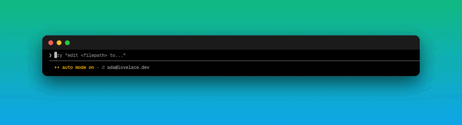
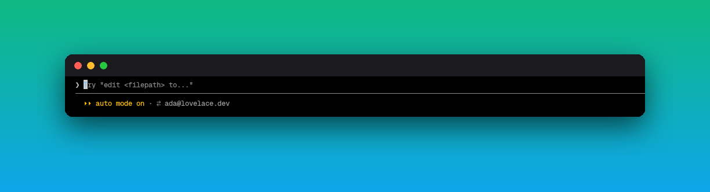
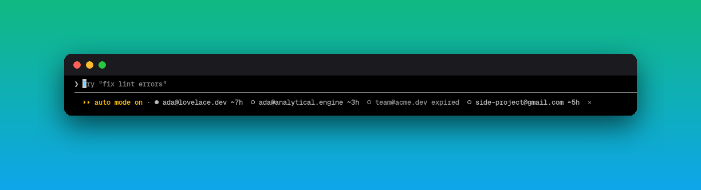

<div align="center">

# quickswitch

**Troque de conta do Claude com um clique — direto na status line do Claude Code.**

Conta do trabalho, conta pessoal, conta do time: um clique no seu e-mail e pronto.

[](LICENSE)
[](#instalação)
[](https://github.com/vyshnavsdeepak/ccswitch)
[](https://github.com/Rocha101/claude-code-quickswitch/stargazers)

[English](README.md) · **Português**



</div>

## Por quê

Bater o limite de uso numa conta enquanto a outra está parada é o pior. O [ccswitch](https://github.com/vyshnavsdeepak/ccswitch) já troca as credenciais do Claude Code sem o vai-e-vem de logout/login — o **quickswitch** deixa isso a um clique, bem onde você já está olhando.

## O que você ganha

Sua conta atual fica na status line, ao lado do modo:



Clicou, o mesmo lugar vira a lista de todas as suas contas, com quanto tempo resta em cada token:



- **●** a conta ativa, em destaque · **○** as outras · tokens expirados apagados
- clicou numa → `ccswitch switch` → um aviso confirma; **✕** fecha sem trocar
- a lista atualiza ao abrir a sessão, depois de cada troca e a cada turno — troca feita em outro terminal também aparece
- nenhuma linha a mais: sem faixa, sem painel, ele *é* parte da status line

## Instalação

Você precisa do [ccswitch](https://github.com/vyshnavsdeepak/ccswitch) com as suas contas adicionadas (`ccswitch add`).

```bash
curl -fsSL https://raw.githubusercontent.com/Rocha101/claude-code-quickswitch/main/install.sh | bash
```

Depois abra uma sessão **nova** do Claude Code.

<details>
<summary>Instalação manual</summary>

```bash
git clone https://github.com/Rocha101/claude-code-quickswitch ~/.claude/mods/claude-code-quickswitch
```

Adicione a pasta em `CLAUDE_CODE_PLUGIN_DIRS` no bloco `env` do `~/.claude/settings.json` (separado por `:`), ou abra o Claude Code com `claude --plugin-dir ~/.claude/mods/claude-code-quickswitch`.

</details>

**Requisitos:** Claude Code 2.1.287+ (mods), [ccswitch](https://github.com/vyshnavsdeepak/ccswitch), `jq`, `git`. O clique precisa de um terminal que informe o mouse (o modo tela cheia do Claude Code); sem isso, `ctrl+x tab` foca e Enter aperta.

## Bom saber

**A troca vale depois de reiniciar.** O ccswitch troca as credenciais salvas; um Claude Code aberto continua na sessão antiga até reiniciar. Depois de trocar: `/exit` e `claude -c` pra continuar de onde parou. O aviso te lembra.

Se você também mostra o e-mail num script próprio de status line, pode tirar — o quickswitch já mostra.

## Como funciona

Um **mod** do Claude Code (`hooks/register.tsx`, ~80 linhas):

1. `session.start` e `turn.complete` rodam `ccswitch list` e leem as contas.
2. `ui.render` no `PromptHint` desenha a conta (ou a lista aberta) no espaço de dica embaixo do prompt.
3. Um clique roda `ccswitch switch <n>` e atualiza.

## Contribuindo

```bash
claude plugin validate .
claude plugin test .
```

Issues e PRs são bem-vindos. Se o quickswitch te salvou de um limite de uso, **[deixa uma estrela](https://github.com/Rocha101/claude-code-quickswitch)** ⭐

Veja também: **[glance](https://github.com/Rocha101/claude-code-glance)** — imagens e HTML renderizado direto no Claude Code.

## Licença

[MIT](LICENSE) © Rocha101 · troca de contas pelo [ccswitch](https://github.com/vyshnavsdeepak/ccswitch)
